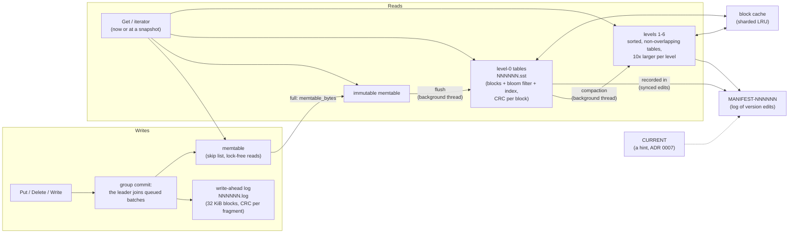

# ForgeDB

[](https://github.com/YanalSerhan/ForgeDB/actions/workflows/ci.yml)

ForgeDB is a crash-safe, embedded key-value storage engine based on a log-structured merge tree
(LSM tree), written in C++20 for Windows 10/11 x64 on NTFS. Writes go to a checksummed write-ahead
log with group commit and into a skip-list memtable that readers search without locks. A
background thread flushes full memtables to immutable, sorted table files with bloom filters and
compacts them through seven levels; a MANIFEST records which files are live, so the database
recovers to a consistent state after a crash. Reads can use snapshots, and table files are read
through memory mappings. The core library has no third-party dependencies.

It is a learning and portfolio project, built in phases with a test for every behavior
([TODO.md](TODO.md) records each phase and how it was measured). **Not for production use.**

**Documentation:** [architecture](docs/architecture.md) (write path, read path, threading,
versions and snapshots), [file formats](docs/file-formats.md) (every byte),
[decision records](docs/adr/README.md) (why), [benchmarks](docs/benchmarks.md) (against
RocksDB, LevelDB and SQLite, and where ForgeDB loses).

```cpp
#include "forgedb/db.h"

FORGEDB_ASSIGN_OR_RETURN(std::unique_ptr<forgedb::DB> db,
                         forgedb::DB::Open(forgedb::Options{}, L"C:\\data\\mydb"));
FORGEDB_RETURN_IF_ERROR(db->Put({.sync = true}, "key", "value"));  // durable when it returns
forgedb::Result<std::string> value = db->Get({}, "key");
std::unique_ptr<forgedb::Iterator> it = db->NewIterator({});
for (it->Seek("k"); it->Valid(); it->Next()) { /* it->key(), it->value() */ }

std::shared_ptr<const forgedb::Snapshot> snapshot = db->GetSnapshot();
FORGEDB_RETURN_IF_ERROR(db->Put({}, "key", "newer"));
value = db->Get({.snapshot = snapshot}, "key");  // still "value"
```

## Architecture



- **Write path.** A write waits in a queue; the writer at the front leads a group, appends it to
  the log as one record (one sync if any member asked for one) and applies it to the memtable.
  Readers see a group all at once, at its last sequence number.
- **Flush.** A full memtable becomes immutable; the write leader syncs the old log, starts a new
  one and goes on writing. A background thread writes the table, syncs it, then appends and
  syncs a version edit in the MANIFEST. A writer waits only if the memtable fills again before
  that flush is done. The old log is deleted after the *next* MANIFEST record, so damage to the
  last record never loses data (ADR 0007).
- **Compaction.** When level 0 holds 4 tables, or a deeper level outgrows its target (10 MiB for
  level 1, ten times more per level), the background thread merges it into the next level,
  dropping versions no reader, not even the oldest snapshot, can see, and deletions with nothing
  older below them. Output tables are cut only between keys. Writes slow down at 8 level-0
  tables and wait at 12. Input tables are deleted once no read uses them and another MANIFEST
  record has followed the compaction's (ADR 0008).
- **Reads.** A `Get` looks in the memtable, the immutable memtable, then the level-0 tables
  newest first, then the one table of each deeper level whose range holds the key (each skipped
  by its bloom filter when it cannot hold the key). Table files are memory-mapped, so a block
  read is a copy from memory, not a system call; a disk error still comes back as an error, not
  a crash. An iterator merges all of them and hides older versions and deletions. A read holds
  the DB's mutex only to take its view (memtables, table list, sequence number), never during
  I/O. A read at a snapshot uses the snapshot's sequence number instead of the latest; the table
  list it takes stays alive (and its files on disk) for as long as the read needs it.
- **Recovery.** The newest MANIFEST with a complete snapshot wins (CURRENT is only a hint,
  because Windows does not document that a rename survives a power loss). The logs written since
  the last flush are replayed; the newest may end at a torn write, which is dropped and reported.
  What was recovered goes into a new table and a new MANIFEST, and leftover files are deleted.

More in [docs/architecture.md](docs/architecture.md); byte layouts in
[docs/file-formats.md](docs/file-formats.md); decisions and their reasons in
[docs/adr/](docs/adr/README.md).

## Results

Against RocksDB 11.8.1, LevelDB and SQLite 3.53.4 on one laptop (Intel Core i7-10750H, NVMe SSD,
Windows 11): 1,000,000 keys of 16 bytes with 100-byte values, one thread, writes not synced, the
same cache, write buffer and Bloom filters for every engine, median of 5 runs.
[docs/benchmarks.md](docs/benchmarks.md) has every workload, the charts, the method, and the
analysis.

| Operations per second | ForgeDB | RocksDB | LevelDB | SQLite |
|---|---|---|---|---|
| Random writes (fillrandom) | 155K | 110K | **163K** | 6.1K |
| Overwrites | 154K | 105K | **155K** | 8.7K |
| Point reads (readrandom) | 188K | 70K | **351K** | 65K |
| Absent keys (readmissing) | 436K | **573K** | 481K | 66K |
| Seek + 10 entries (seekrandom) | 60K | 37K | **142K** | 49K |
| Full scan, entries/s (readseq) | 2.55M | 2.74M | **4.06M** | 2.35M |
| Write amplification, random writes | **6.04** | 6.43 | 6.32 | 115 |

ForgeDB is ahead of RocksDB and SQLite on writes and point reads, and behind LevelDB on reads,
seeks and scans (1.6–2.4 times), for reasons the benchmark page goes through. Profiling in Phase
5 found that half of a point read's time was a system call per block; reading table files through
memory mappings made point reads 53% faster and seeks 89% faster. Synced writes are bound by the
drive: about 1,600–1,750 per second at best, whatever the engine.

## Features, with measured numbers

Numbers are from one machine (Intel Core i7-10750H laptop, `msvc-release`) unless marked Linux;
they are recorded in [TODO.md](TODO.md) with how they were measured, and the phase they come from.

- **Crash safety, tested by simulation.** A fault-injection file system models what Windows
  documents about power loss and crashes (ADR 0002), including unsynced data dropped, torn or
  partly kept, and renames and removals undone. Phase 2 exit gate: 10,002 simulated crashes in
  each of 6 variants with no synced write lost. `FlushCrashTest` crashes at every file operation
  of 120 writes with 2 flushes (523 operations) and of an open (28), twice each.
- **Real process kills.** 500 runs killing a writer with `TerminateProcess`: 100,218 acknowledged
  keys checked, none lost.
- **Group commit.** Synced writes: 1.93 k/s with 1 thread, 8.86 k/s with 8 threads.
- **Write amplification.** 1,000,000 random 16-byte keys with 100-byte values, default options,
  unsynced: 5.26–5.37 bytes written to tables per byte written by the user once compaction has
  settled (5.08–5.18 when the last write returns), at 137–142 k writes/s with no stalls (3 runs;
  `BM_FillRandomWriteAmplification`, Phase 4). Sequential writes are never rewritten: sorted
  tables move down a level whole (write amplification 2.18 with the log counted, as LevelDB's).
- **Bloom filters.** 10 bits per key: 0.817% false positives at 100,000 keys (Linux; 0.82%
  predicted). A `Get` for a missing key read a data block 845 times in 100,000.
- **Corruption detection.** Every log fragment, table block and footer has a CRC-32C. The
  corruption suite (below) damages tables, logs and MANIFESTs at random: reads give the right
  answer or a `Corruption` status, never a wrong one.
- **Checked against a model.** 3 seeds × 1,000,000 random operations, with reopens and about 80
  flushes per seed, agree with `std::map`; snapshot reads agree with copies of the map taken with
  each snapshot; a third run compacts through tiny levels so data reaches level 3.
- **Statistics.** `DB::GetStats()`: bytes written by users and to the log, flushes and
  compactions (count, bytes read and written, time, per level), write amplification, stalls, and
  each level's size. Counted from the open, not saved; `forgedb_cli stats` prints them.
- **Tools.** `forgedb_sst_dump` prints and checks a table file; `forgedb_cli` runs `put`, `get`,
  `delete`, `scan` and `stats` (tables per level, statistics, and what recovery found) from the
  command line.

## Quick start: build and test on Windows

### Prerequisites (one time)

1. **Visual Studio 2022 (17.5 or newer) or later**, with the *Desktop development with C++*
   workload and these individual components:
   - *C++ CMake tools for Windows* (provides CMake 3.25+ and Ninja)
   - *C++ Clang Compiler for Windows* (provides `clang-cl`; needed for the `clangcl-*` presets)
2. **vcpkg** (dependencies for tests and benchmarks only), in a normal PowerShell:

   ```powershell
   git clone https://github.com/microsoft/vcpkg C:\vcpkg
   C:\vcpkg\bootstrap-vcpkg.bat -disableMetrics
   [Environment]::SetEnvironmentVariable("VCPKG_ROOT", "C:\vcpkg", "User")
   ```

### Every session: open an x64 developer shell

The default *Developer PowerShell for VS* targets **x86**. ForgeDB is x64-only, so start the
shell for x64 explicitly:

```powershell
$vs = & "${env:ProgramFiles(x86)}\Microsoft Visual Studio\Installer\vswhere.exe" -latest -property installationPath
& "$vs\Common7\Tools\Launch-VsDevShell.ps1" -Arch amd64 -HostArch amd64 -SkipAutomaticLocation
$env:VCPKG_ROOT = "C:\vcpkg"   # the developer shell may point this at Visual Studio's own vcpkg
```

### Clone, configure, build, test

```powershell
git clone https://github.com/YanalSerhan/ForgeDB C:\path\to\ForgeDB
cd C:\path\to\ForgeDB
cmake --preset msvc-debug        # first run also builds GoogleTest through vcpkg (a few minutes)
cmake --build --preset msvc-debug
ctest --preset msvc-debug
```

| Preset          | Compiler | Build type     | Notes                                   |
|-----------------|----------|----------------|-----------------------------------------|
| `msvc-debug`    | MSVC     | Debug          | assertions on                           |
| `msvc-release`  | MSVC     | Release        | also builds microbenchmarks             |
| `msvc-asan`     | MSVC     | RelWithDebInfo | AddressSanitizer, assertions on         |
| `clangcl-debug` | clang-cl | Debug          | assertions on                           |
| `clangcl-asan`  | clang-cl | RelWithDebInfo | AddressSanitizer, assertions on         |
| `clangcl-tidy`  | clang-cl | Debug          | clang-tidy on every file; build only    |
| `msvc-analyze`  | MSVC     | Debug          | `/analyze` on the library; build only   |
| `clangcl-fuzz`  | clang-cl | RelWithDebInfo | libFuzzer + ASan; library and fuzz targets; `ctest` runs a 60 s fuzz smoke test per target |
| `msvc-bench`    | MSVC     | Release        | `forgedb_bench` with RocksDB, LevelDB and SQLite too; `ctest` runs only the benchmark tool's tests. Not in `build-all.ps1`'s default list or CI; the first configure builds RocksDB through vcpkg (tens of minutes) |

Build output goes to `out/build/<preset>/`. Microbenchmarks (release preset only):
`out\build\msvc-release\bench\forgedb_microbench.exe`.

### Reproduce the benchmarks

```powershell
# Once, in an administrator PowerShell: keep Defender out of the benchmark's folder, and use
# the High performance power plan (or Settings > System > Power > Power mode: Best performance).
Add-MpPreference -ExclusionPath C:\path\to\ForgeDB\out\bench-db
powercfg /setactive SCHEME_MIN
pip install matplotlib            # for the charts (optional)

# A quick look (the first run also builds RocksDB through vcpkg, about 15 minutes):
powershell -ExecutionPolicy Bypass -File scripts\bench.ps1 -Runs 1 -Num 100000 -SyncNum 2000

# The full run behind the results above (several hours: the first full run took about 4 h 20 min);
# plugged in, other heavy programs closed:
powershell -ExecutionPolicy Bypass -File scripts\bench.ps1 -SyncNum 20000
```

Results, charts and a `machine.json` record go to `out\bench\<date-time>\`; the method is in
[docs/benchmarks.md](docs/benchmarks.md#method).

To configure, build and test **every** preset in one go (it sets up the x64 developer environment
itself, prints a summary table and writes logs to `out\logs\`):

```powershell
powershell -ExecutionPolicy Bypass -File scripts\build-all.ps1
powershell -ExecutionPolicy Bypass -File scripts\build-all.ps1 -Presets msvc-debug,clangcl-asan -Clean
powershell -ExecutionPolicy Bypass -File scripts\build-all.ps1 -Quick
```

`-Quick` is for small steps: `msvc-release` and `clangcl-tidy` only (unless `-Presets` names
others), with the long tests at the debug presets' sizes. Phase gates and engine changes get the
full run.

Other scripts (same environment setup, usable locally and in CI):

```powershell
powershell -ExecutionPolicy Bypass -File scripts\check-format.ps1        # add -Fix to reformat
powershell -ExecutionPolicy Bypass -File scripts\coverage.ps1            # after building msvc-debug;
                                                                         # needs: choco install opencppcoverage
powershell -ExecutionPolicy Bypass -File scripts\fuzz.ps1                # 1 hour per fuzz target; -Seconds N
powershell -ExecutionPolicy Bypass -File scripts\bench.ps1               # ForgeDB vs RocksDB, LevelDB, SQLite;
                                                                         # several hours; see docs/benchmarks.md
powershell -ExecutionPolicy Bypass -File scripts\cpu-profile.ps1         # CPU profile of one workload on ForgeDB
                                                                         # (Visual Studio's profiler); -Workload X
```

## Testing

| Suite | What it checks |
|-------|----------------|
| `forgedb_unit_tests` | every component; the `FileSystem` contract against each implementation |
| `forgedb_model_tests` | random operations, including closing and reopening, compared with `std::map` (3 seeds × 1,000,000 operations in release builds) |
| `forgedb_crash_tests` | crash torture: thousands of simulated crashes on the fault-injection file system, including during flushes; process kill: real crashes with `TerminateProcess` |
| `forgedb_corruption_tests` | bit flips, random or zeroed runs and truncations in tables, logs and MANIFESTs: the open fails with `Corruption`, or every read is right or `Corruption` (500 trials per file type in release builds) |
| `forgedb_stress_tests` | 8 reader threads (Gets, scans, snapshot reads) and 1 to 4 writer threads on one database while it flushes and compacts, on real files and in memory: every read must be a state that existed while it ran, and a pause every 2 minutes compares the whole database with a model and reopens it (5 or 10 seconds per ctest run) |
| fuzz targets (`clangcl-fuzz`) | on untrusted bytes: the log reader, write batch decoding, blocks, table files, version edits and MANIFEST recovery |

**What the crash tests cover.** The process-kill test kills a real process on Windows, so it covers
process crashes: data the operating system has accepted survives them. Power loss and operating
system crashes cannot be produced on real hardware in a test; they are covered only by the
fault-injection model of what Windows documents (ADR 0002), which the crash torture test runs.

Longer runs than CI's: `FORGEDB_CRASH_CYCLES=10000` and `FORGEDB_KILL_RUNS=500` (environment
variables for `forgedb_crash_tests`), `FORGEDB_CORRUPTION_TRIALS=5000` (for
`forgedb_corruption_tests`), `scripts\fuzz.ps1`, and `scripts\stress.ps1` (by default three
10-minute stress runs in the `msvc-asan` build, the Phase 4 exit gate).

## Tools

Built with the library by every preset except `clangcl-fuzz` (in `out\build\<preset>\tools\`):

```text
forgedb_sst_dump [--blocks] [--entries] <file.sst>...
    footer, index, filter, entry counts, key and sequence ranges; checks every block's CRC,
    key order, index keys and the filter. Exit code 0: no damage; 1: damage found; 2: error.

forgedb_cli <db-dir> put <key> <value>     synced; creates the database if needed
forgedb_cli <db-dir> get <key>             exit code 1 if not found
forgedb_cli <db-dir> delete <key>
forgedb_cli <db-dir> scan [--from <key>] [--limit <n>]
forgedb_cli <db-dir> stats                 tables per level, last sequence, statistics, recovery

forgedb_bench [--engine=forgedb,rocksdb,leveldb,sqlite] [--workloads=...] [--num=1000000]
              [--value_size=100] [--sync=1] [--threads=N] [--runs=5] [--json=results.json] ...
    fillseq, fillrandom, overwrite, readrandom, readmissing, readseq, seekrandom, mixed:
    ops/s, MB/s, latency p50/p99/max, write and space amplification; reads check their
    answers. Only meaningful from a release build (tools/bench/bench_options.h lists every
    option). RocksDB, LevelDB and SQLite only in the msvc-bench build; how each engine's
    settings are matched: tools/bench/*_engine.h.
```

Every `forgedb_cli` command opens the database and so runs recovery: writes left in the log
become a level-0 table. The statistics `stats` prints count from that open, so they show what the
command's own open did (a compaction it set off, for example; not the recovery table). Output is
UTF-8; `scan` escapes bytes that are not printable ASCII.

## Known limitations

- Windows 10/11 x64 only, built with MSVC or clang-cl (ADR 0001). Not for production use.
- One process per database (enforced by the `LOCK` file); no transactions beyond an atomic
  `WriteBatch`.
- Power-loss safety is verified with a simulated file system; real behavior also depends on the
  drive honoring flush requests ("Turn off Windows write-cache buffer flushing" voids it; ADR
  0002). There is no data-race detector on Windows. Concurrency is verified by design (ADR
  0009), by Clang's thread-safety analysis in the clang-cl builds (which mutex guards what is a
  compile error to get wrong), by stress tests and assertions, and, during development, by
  ThreadSanitizer runs of the portable code on Linux.
- Snapshots are not saved: they end when the DB is closed.
- Damage to the newest log drops the writes after it instead of failing the open (point-in-time
  recovery, reported in `RecoveryInfo` and by `forgedb_cli stats`; ADR 0004 rule 6). A newest log
  truncated exactly at a record boundary cannot be told from one whose last writes never reached
  the disk, so that loss is not reported.
- File systems without POSIX delete semantics (FAT32, some network shares) keep a removed file's
  name until its last handle closes (ADR 0002, rule 7). Paths are limited to `MAX_PATH` unless
  Windows long paths are enabled.
- A disk error while reading a memory-mapped table should come back as an `IOError` (ADR 0002,
  rule 12), but no test can make a disk fail, so that path is untested.
- The benchmarks come from one laptop and one SSD. Synced-write speed there depends on which of
  two flush times the drive gives, in a pattern that is not explained
  ([docs/benchmarks.md](docs/benchmarks.md#results-synced-writes-2026-11-05)).

## Continuous integration

GitHub Actions on `windows-2025-vs2026` (`.github/workflows/ci.yml`; the badge at the top is this
workflow): one job per preset running `scripts\build-all.ps1`, so every build with warnings as
errors, the tests in the debug, release and both ASan builds, clang-tidy and `/analyze`, and the
fuzz smoke test in the `clangcl-fuzz` job; a coverage job (OpenCppCoverage, fails below 85% of
lines, report uploaded as an artifact); and a clang-format check. vcpkg packages are cached
between runs. ASan builds include a canary test that overflows a heap buffer on purpose and
passes only if ASan reports it.

**Troubleshooting.** Other toolchains on `PATH` can shadow Visual Studio's tools; Strawberry Perl,
for example, ships its own `cmake.exe`, `ninja.exe`, `gcc` and `ld.exe`. `build-all.ps1` puts
Visual Studio's CMake, Ninja and clang-cl first. In a manual shell, check with
`where.exe cmake ninja clang-cl`, and delete `out\build\<preset>` after fixing `PATH`, because
CMake caches the tool paths it found.
