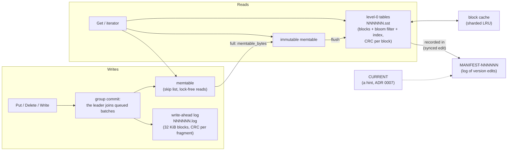

# ForgeDB

[](https://github.com/YanalSerhan/ForgeDB/actions/workflows/ci.yml)

ForgeDB is a crash-safe, embedded key-value storage engine based on a log-structured merge tree
(LSM tree), written in C++20 for Windows 10/11 x64 on NTFS. Writes go to a checksummed write-ahead
log with group commit and into a skip-list memtable that readers search without locks. Full
memtables are flushed to immutable, sorted table files with bloom filters, and a MANIFEST records
which files are live, so the database recovers to a consistent state after a crash. The core
library has no third-party dependencies.

**Status: Phase 3 done (table files, flush, MANIFEST, tools, corruption tests).** Nothing compacts
level-0 tables yet (Phase 4), so reads slow down as tables accumulate. Not for production use.
See [TODO.md](TODO.md) for the plan.

```cpp
#include "forgedb/db.h"

FORGEDB_ASSIGN_OR_RETURN(std::unique_ptr<forgedb::DB> db,
                         forgedb::DB::Open(forgedb::Options{}, L"C:\\data\\mydb"));
FORGEDB_RETURN_IF_ERROR(db->Put({.sync = true}, "key", "value"));  // durable when it returns
forgedb::Result<std::string> value = db->Get({}, "key");
std::unique_ptr<forgedb::Iterator> it = db->NewIterator({});
for (it->Seek("k"); it->Valid(); it->Next()) { /* it->key(), it->value() */ }
```

## Architecture



- **Write path.** A write waits in a queue; the writer at the front leads a group, appends it to
  the log as one record (one sync if any member asked for one) and applies it to the memtable.
  Readers see a group all at once, at its last sequence number.
- **Flush.** A full memtable becomes immutable; the leader syncs the old log, starts a new one,
  writes the table, syncs it, then appends and syncs a version edit in the MANIFEST. The old log
  is deleted after the *next* MANIFEST record, so damage to the last record never loses data
  (ADR 0007).
- **Reads.** A `Get` looks in the memtable, the immutable memtable, then the level-0 tables
  newest first (each skipped by its bloom filter when it cannot hold the key). An iterator merges
  all of them and hides older versions and deletions. A read holds the DB's mutex only to take
  its view (memtables, table list, sequence number), never during I/O.
- **Recovery.** The newest MANIFEST with a complete snapshot wins (CURRENT is only a hint,
  because Windows does not document that a rename survives a power loss). The logs written since
  the last flush are replayed; the newest may end at a torn write, which is dropped and reported.
  What was recovered goes into a new table and a new MANIFEST, and leftover files are deleted.

Byte layouts: [docs/file-formats.md](docs/file-formats.md). Decisions and their reasons:
[docs/adr/](docs/adr/README.md).

## Features, with measured numbers

Numbers are from one machine (Intel Core i7-10750H laptop, `msvc-release`) unless marked Linux;
they are recorded in [TODO.md](TODO.md) with how they were measured.

- **Crash safety, tested by simulation.** A fault-injection file system models what Windows
  documents about power loss and crashes (ADR 0002), including unsynced data dropped, torn or
  partly kept, and renames and removals undone. Phase 2 exit gate: 10,002 simulated crashes in
  each of 6 variants with no synced write lost. `FlushCrashTest` crashes at every file operation
  of 120 writes with 2 flushes (523 operations) and of an open (28), twice each.
- **Real process kills.** 500 runs killing a writer with `TerminateProcess`: 100,218 acknowledged
  keys checked, none lost.
- **Group commit.** Synced writes: 1.93 k/s with 1 thread, 8.86 k/s with 8 threads.
- **Bloom filters.** 10 bits per key: 0.817% false positives at 100,000 keys (Linux; 0.82%
  predicted). A `Get` for a missing key read a data block 845 times in 100,000.
- **Corruption detection.** Every log fragment, table block and footer has a CRC-32C. The
  corruption suite (below) damages tables, logs and MANIFESTs at random: reads give the right
  answer or a `Corruption` status, never a wrong one.
- **Checked against a model.** 3 seeds × 1,000,000 random operations, with reopens and about 80
  flushes per seed, agree with `std::map`.
- **Tools.** `forgedb_sst_dump` prints and checks a table file; `forgedb_cli` runs `put`, `get`,
  `delete`, `scan` and `stats` (tables per level, and what recovery found) from the command line.

## Building on Windows

### Prerequisites (one time)

1. **Visual Studio 2022 (17.5 or newer) or later**, with the *Desktop development with C++*
   workload and these individual components:
   - *C++ CMake tools for Windows* (provides CMake 3.25+ and Ninja)
   - *C++ Clang Compiler for Windows* (provides `clang-cl`; needed for the `clangcl-*` presets)
2. **vcpkg** (dependencies for tests and benchmarks only), in a normal PowerShell:

   ```powershell
   git clone https://github.com/microsoft/vcpkg C:\vcpkg
   C:\vcpkg\bootstrap-vcpkg.bat -disableMetrics
   [Environment]::SetEnvironmentVariable("VCPKG_ROOT", "C:\vcpkg", "User")
   ```

### Every session: open an x64 developer shell

The default *Developer PowerShell for VS* targets **x86**. ForgeDB is x64-only, so start the
shell for x64 explicitly:

```powershell
$vs = & "${env:ProgramFiles(x86)}\Microsoft Visual Studio\Installer\vswhere.exe" -latest -property installationPath
& "$vs\Common7\Tools\Launch-VsDevShell.ps1" -Arch amd64 -HostArch amd64 -SkipAutomaticLocation
$env:VCPKG_ROOT = "C:\vcpkg"   # the developer shell may point this at Visual Studio's own vcpkg
```

### Configure, build, test

```powershell
cd C:\path\to\ForgeDB
cmake --preset msvc-debug        # first run also builds GoogleTest through vcpkg (a few minutes)
cmake --build --preset msvc-debug
ctest --preset msvc-debug
```

| Preset          | Compiler | Build type     | Notes                                   |
|-----------------|----------|----------------|-----------------------------------------|
| `msvc-debug`    | MSVC     | Debug          | assertions on                           |
| `msvc-release`  | MSVC     | Release        | also builds microbenchmarks             |
| `msvc-asan`     | MSVC     | RelWithDebInfo | AddressSanitizer, assertions on         |
| `clangcl-debug` | clang-cl | Debug          | assertions on                           |
| `clangcl-asan`  | clang-cl | RelWithDebInfo | AddressSanitizer, assertions on         |
| `clangcl-tidy`  | clang-cl | Debug          | clang-tidy on every file; build only    |
| `msvc-analyze`  | MSVC     | Debug          | `/analyze` on the library; build only   |
| `clangcl-fuzz`  | clang-cl | RelWithDebInfo | libFuzzer + ASan; library and fuzz targets; `ctest` runs a 60 s fuzz smoke test per target |

Build output goes to `out/build/<preset>/`. Microbenchmarks (release preset only):
`out\build\msvc-release\bench\forgedb_microbench.exe`.

To configure, build and test **every** preset in one go (it sets up the x64 developer environment
itself, prints a summary table and writes logs to `out\logs\`):

```powershell
powershell -ExecutionPolicy Bypass -File scripts\build-all.ps1
powershell -ExecutionPolicy Bypass -File scripts\build-all.ps1 -Presets msvc-debug,clangcl-asan -Clean
```

Other scripts (same environment setup, usable locally and in CI):

```powershell
powershell -ExecutionPolicy Bypass -File scripts\check-format.ps1        # add -Fix to reformat
powershell -ExecutionPolicy Bypass -File scripts\coverage.ps1            # after building msvc-debug;
                                                                         # needs: choco install opencppcoverage
powershell -ExecutionPolicy Bypass -File scripts\fuzz.ps1                # 1 hour per fuzz target; -Seconds N
```

## Testing

| Suite | What it checks |
|-------|----------------|
| `forgedb_unit_tests` | every component; the `FileSystem` contract against each implementation |
| `forgedb_model_tests` | random operations, including closing and reopening, compared with `std::map` (3 seeds × 1,000,000 operations in release builds) |
| `forgedb_crash_tests` | crash torture: thousands of simulated crashes on the fault-injection file system, including during flushes; process kill: real crashes with `TerminateProcess` |
| `forgedb_corruption_tests` | bit flips, random or zeroed runs and truncations in tables, logs and MANIFESTs: the open fails with `Corruption`, or every read is right or `Corruption` (500 trials per file type in release builds) |
| fuzz targets (`clangcl-fuzz`) | on untrusted bytes: the log reader, write batch decoding, blocks, table files, version edits and MANIFEST recovery |

**What the crash tests cover.** The process-kill test kills a real process on Windows, so it covers
process crashes: data the operating system has accepted survives them. Power loss and operating
system crashes cannot be produced on real hardware in a test; they are covered only by the
fault-injection model of what Windows documents (ADR 0002), which the crash torture test runs.

Longer runs than CI's: `FORGEDB_CRASH_CYCLES=10000` and `FORGEDB_KILL_RUNS=500` (environment
variables for `forgedb_crash_tests`), `FORGEDB_CORRUPTION_TRIALS=5000` (for
`forgedb_corruption_tests`), and `scripts\fuzz.ps1`.

## Tools

Built with the library by every preset except `clangcl-fuzz` (in `out\build\<preset>\tools\`):

```text
forgedb_sst_dump [--blocks] [--entries] <file.sst>...
    footer, index, filter, entry counts, key and sequence ranges; checks every block's CRC,
    key order, index keys and the filter. Exit code 0: no damage; 1: damage found; 2: error.

forgedb_cli <db-dir> put <key> <value>     synced; creates the database if needed
forgedb_cli <db-dir> get <key>             exit code 1 if not found
forgedb_cli <db-dir> delete <key>
forgedb_cli <db-dir> scan [--from <key>] [--limit <n>]
forgedb_cli <db-dir> stats                 tables per level, last sequence, recovery report
```

Every `forgedb_cli` command opens the database and so runs recovery: writes left in the log
become a level-0 table. Output is UTF-8; `scan` escapes bytes that are not printable ASCII.

## Known limitations

- One process per database (enforced by the `LOCK` file); no transactions beyond an atomic
  `WriteBatch`.
- Power-loss safety is verified with a simulated file system; real behavior also depends on the
  drive honoring flush requests ("Turn off Windows write-cache buffer flushing" voids it; ADR
  0002). There is no data-race detector on Windows; concurrency is verified by design, stress
  tests and assertions (and, during development, ThreadSanitizer runs of the portable code on
  Linux).
- Until compaction (Phase 4), every flush and every open with unflushed writes adds a level-0
  table, and reads consider every level-0 table.
- Damage to the newest log drops the writes after it instead of failing the open (point-in-time
  recovery, reported in `RecoveryInfo` and by `forgedb_cli stats`; ADR 0004 rule 6). A newest log
  truncated exactly at a record boundary cannot be told from one whose last writes never reached
  the disk, so that loss is not reported.
- File systems without POSIX delete semantics (FAT32, some network shares) keep a removed file's
  name until its last handle closes (ADR 0002, rule 7). Paths are limited to `MAX_PATH` unless
  Windows long paths are enabled.

## Continuous integration

GitHub Actions on `windows-2025-vs2026` (`.github/workflows/ci.yml`): one job per preset running
`scripts\build-all.ps1` (the `clangcl-fuzz` job runs the fuzz smoke test), a coverage job
(OpenCppCoverage, report uploaded as an artifact), and a clang-format check. vcpkg packages are cached between runs. ASan builds include a canary test
that overflows a heap buffer on purpose and passes only if ASan reports it.

**Troubleshooting.** Other toolchains on `PATH` can shadow Visual Studio's tools; Strawberry Perl,
for example, ships its own `cmake.exe`, `ninja.exe`, `gcc` and `ld.exe`. `build-all.ps1` puts
Visual Studio's CMake, Ninja and clang-cl first. In a manual shell, check with
`where.exe cmake ninja clang-cl`, and delete `out\build\<preset>` after fixing `PATH`, because
CMake caches the tool paths it found.
