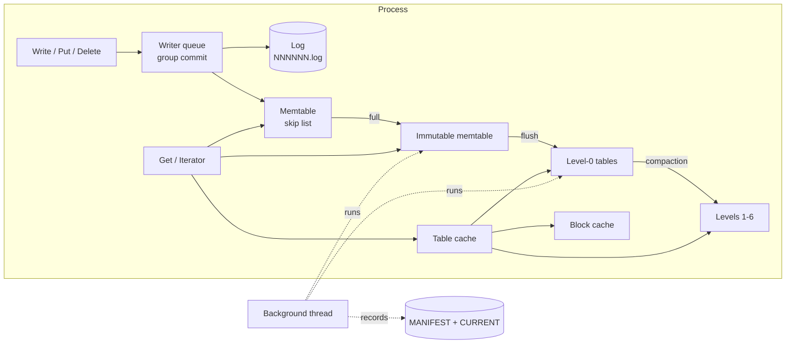
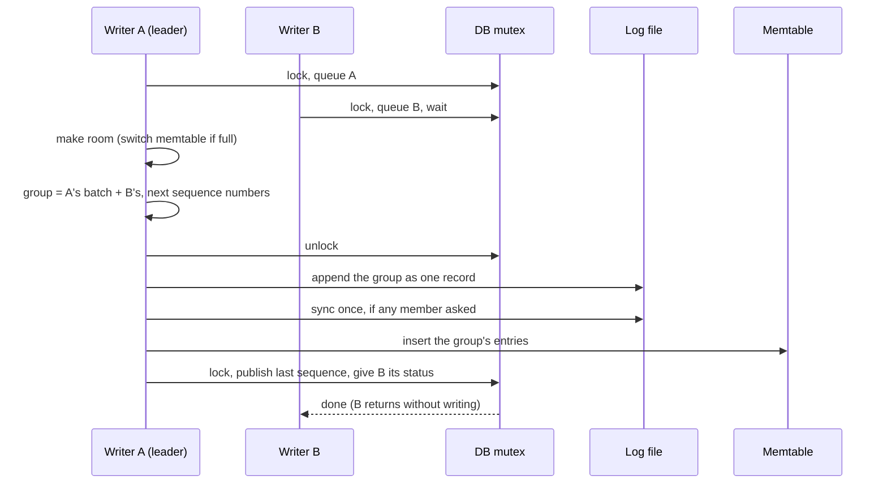

# ForgeDB architecture

How ForgeDB works, from a write to the disk and back: the write path, the background thread, the
read path, threading, and versions and snapshots. Byte layouts are in
[file-formats.md](file-formats.md); the reasons behind each decision are in the
[ADRs](adr/README.md). Every section names the code it describes, and the code's own header
comments go into more detail.

## The pieces

| Directory | What it holds |
|---|---|
| `include/forgedb/` | The public API: `DB`, `Options`, `WriteBatch`, `Iterator`, `Snapshot`, `Status`, `Result`, `DBStats` |
| `src/db/` | `DBImpl` (write path, background thread, reads, recovery), versions and the MANIFEST, compaction picking, the DB iterator, snapshots, the table cache |
| `src/memtable/` | The arena, the skip list, the memtable |
| `src/log/` | The write-ahead log's writer and reader (also used for the MANIFEST) |
| `src/table/` | Blocks, the Bloom filter, the table builder and reader, the merging iterator |
| `src/env/` | The `FileSystem` interface and its Windows (`WinFileSystem`) and in-memory (`MemFileSystem`) versions; the only code that calls Win32 |
| `src/util/` | Encoding, CRC-32C, hashing, the LRU cache, the annotated mutex |

Everything below `src/env/` reaches files only through `FileSystem`, so the same engine runs on
real files and, in the tests, on an in-memory file system that can simulate crashes and power
loss (the fault-injection file system in `tests/support/`).

## Write path

Code: `DBImpl::Write`, `BuildGroup`, `MakeRoomForWrite`, `SwitchMemtable` (`src/db/db_impl.cpp`).

- **Group commit.** Every write (`Put`, `Delete`, `Write` of a `WriteBatch`) queues under the DB
  mutex. The writer at the front leads: it joins its batch with the batches queued behind it (up
  to a size cap), numbers them with the next sequence numbers, and, **with the mutex released**,
  appends the group to the log as one record, syncs the log once if any member asked for
  `sync`, and inserts the entries into the memtable. Back under the mutex it publishes the
  group by advancing the last sequence number, hands every member the shared status, and wakes
  the next writer in line. One sync serves the whole group: synced writes went from 1.93 to 8.86
  thousand per second with 8 threads (README).
- **All or nothing.** Readers read at the published sequence number, so a group (and every batch
  in it) appears at once or not at all.
- **Durability levels.** An acknowledged unsynced write has reached the operating system: it
  survives a crash of the process, not of the machine. A synced write has been flushed to the
  drive with `FlushFileBuffers` (ADR 0002).
- **Switching memtables.** When the memtable reaches `memtable_bytes` (4 MiB), the leader syncs
  the current log, starts a new one, turns the memtable into the *immutable memtable* and hands
  it to the background thread. Syncing first means a crash can damage only the newest log, so
  recovery always yields a prefix of the writes, never a hole.
- **Stalls.** A writer waits while the last flush still runs and the memtable is full again. With
  8 or more level-0 tables, each write first sleeps 1 ms, once, so compaction can catch up; with
  12, a writer that needs a new memtable waits for compaction (ADR 0008, rule 6).
- **Errors are sticky.** If an append, sync, flush or compaction fails, what is on disk is unknown:
  every member of the group gets the error, and every later write fails with it. Reads go on.

## Background thread: flushes and compactions

Code: `DBImpl::BackgroundThread`, `DoFlush`, `DoCompaction`, `RunCompaction`
(`src/db/db_impl.cpp`); `src/db/compaction.*`. Design: ADR 0007, ADR 0008.

One thread does one job at a time, flushes first.

- **Flush.** Writes the immutable memtable to a new level-0 table, syncs it, records it in the
  MANIFEST (synced), installs the new version, and drops the immutable memtable.
- **Compaction.** When a level scores 1 or more (level 0: its table count over 4; level *n*: its
  bytes over 10 MiB × 10*n*−1), the highest-scoring level is compacted:
  - from level 0, every table (they may overlap); from a deeper level, one table, round-robin;
    plus every table of the next level that overlaps them;
  - the inputs are merged into new tables one level down, cut only between user keys (so a key's
    versions never straddle two tables) at about 2 MiB;
  - a version of a key is dropped when a newer one at or below the oldest snapshot hides it, and
    a deletion when nothing older of its key remains below (ADR 0008, rule 4);
  - **moves:** inputs that overlap nothing in the next level, and not each other, move down
    unchanged instead (Phase 5.3: sequential writes are never rewritten);
  - the result is one MANIFEST edit, synced after the new tables are.
  A long compaction checks every 256 entries whether a flush is waiting, and runs it in between,
  so writes don't stall behind it.
- **File deletion.** Nothing is deleted before the MANIFEST no longer needs it, and one record
  later: the MANIFEST's last record can be damaged by a crash and is then ignored (ADR 0007), so
  the files it would have retired must still be there. A log is deleted one flush after the flush
  that retired it; a compaction's input table once no version in use lists it and another record
  has followed. At open, everything the new MANIFEST does not list goes.

## Read path

Code: `DBImpl::Get`, `DBImpl::NewIterator` (`src/db/db_impl.cpp`); `src/table/table.*`,
`src/db/table_cache.*`, `src/db/db_iter.*`, `src/db/level_iterator.*`,
`src/table/merging_iterator.*`; `src/env/win_file_system.cpp`.

- **What a read sees.** Under the DB mutex a read takes four things: the memtable, the immutable
  memtable, the current version (the list of tables per level) and a sequence number (the last
  published one, or the snapshot's). It then works without the mutex; what it took stays alive
  as long as it needs it (reference counts and `shared_ptr`).
- **`Get`, newest data first:** the memtable, the immutable memtable, every level-0 table whose
  range holds the key (newest first; they may overlap), then in each deeper level the one table
  whose range can hold it. The first entry for the key at or below the sequence number decides:
  a value is the answer, a deletion means not found.
- **Inside a table:** the table's Bloom filter (10 bits per key, about 0.8% false positives)
  rules out most tables that don't have the key without reading anything; the index block
  (in memory while the table is open) names the one data block that can hold it; the block
  comes from the block cache (8 MiB, LRU) or from the file.
- **Open tables** are kept by the table cache (up to 1,000, LRU), each with its index and filter
  in memory. Since Phase 5.3 a table file is **memory-mapped** when opened, and a block read is a
  copy from the mapping instead of a `ReadFile` call (ADR 0002, rule 12): the profile showed the
  system call to be half of a random read's time. A disk error inside the mapping still comes back
  as an `IOError`.
- **Iterators** merge the same sources: a memtable iterator for each memtable, a table iterator
  for each level-0 table, and one *level iterator* per deeper level that opens its tables one at a
  time. The merging iterator yields every version of every key in order; the *DB iterator* above
  it shows each live key once, with its newest value visible at the iterator's sequence number,
  and re-seeks past long runs of hidden versions instead of stepping over them (ADR 0003). An
  iterator holds its version, so the tables it reads are not deleted under it.

## Threading

Code: `src/util/mutex.h`, `src/util/thread_annotations.h`. Design: ADR 0009.

- **One DB mutex** guards all of the DB's shared state: the writer queue, the memtables, the
  current version, the last sequence number, the background thread's jobs, the statistics, the
  sticky error. It is **never held during I/O**: log appends and syncs, table writes, reads and
  file deletions all run with it released.
- **Checked by the compiler.** Every guarded member is marked `FORGEDB_GUARDED_BY(mutex_)`, and
  the clang-cl builds compile with Clang's thread-safety analysis as an error: touching a
  guarded member without the mutex does not compile. (Windows has no ThreadSanitizer; this and
  the stress test are the replacement.)
- **Roles.** Only the write leader touches the log and the memtable's write side; only the
  background thread uses the version set (except for taking file numbers, an atomic counter).
  The memtable's skip list has one writer and lock-free readers (release/acquire pointers; nodes
  are never removed).
- **Other locks:** the snapshot list and each shard of the two caches have their own mutex. The
  snapshot list's may be taken while holding the DB mutex, never the reverse; the cache shards'
  are taken without the DB mutex.

## Versions, snapshots and the MANIFEST

Code: `src/db/version_set.*`, `src/db/version_edit.*`, `src/db/snapshot.*`. Design: ADR 0007.

- **Sequence numbers.** Every entry carries a 56-bit sequence number and a type (value or
  deletion) after its user key: the *internal key*. Entries of one user key sort newest first.
- **Versions.** A version is an immutable list of tables per level, shared by `shared_ptr`.
  Flushes and compactions make new versions; old ones live as long as a read uses them, and a
  table is deleted only when no live version lists it.
- **The MANIFEST** records every change as an edit, synced before the change takes effect. Its
  first record is a full snapshot of the state. At every open a new MANIFEST is written and
  CURRENT is switched to it (write `CURRENT.tmp`, sync, rename). Because Windows does not document
  that a rename survives a power loss, recovery does not trust CURRENT: it uses the newest
  MANIFEST whose first record is complete.
- **Snapshots.** A snapshot is a sequence number registered with the DB; reading with it reads as
  of that point. Compaction keeps every version a live snapshot can still see, and drops the rest.
  Snapshots are not saved: they end when the DB is closed.

## Opening and recovery

Code: `DBImpl::Recover`, `ReplayLog`, `DeleteObsoleteFiles` (`src/db/db_impl.cpp`). Design: ADR
0004, ADR 0007.

Open takes the `LOCK` file for the life of the DB (one process per database), picks the MANIFEST
to trust, and replays the logs it does not cover yet, checking that sequence numbers continue
exactly. Every log but the newest is read strictly; the newest may end in a torn write, which is
dropped and reported, and real damage there drops the writes after it (point-in-time recovery,
reported in `RecoveryInfo`). What was recovered goes into a level-0 table, a new log and a new
MANIFEST start, and files nothing needs any more are deleted.
