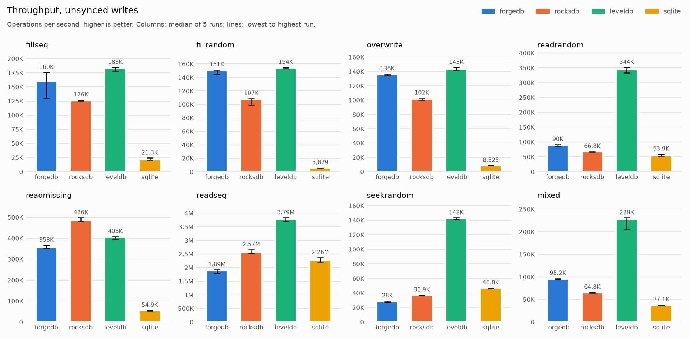
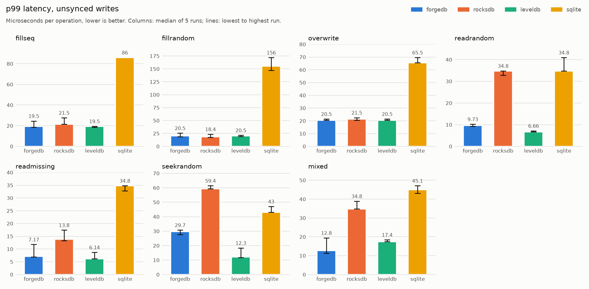
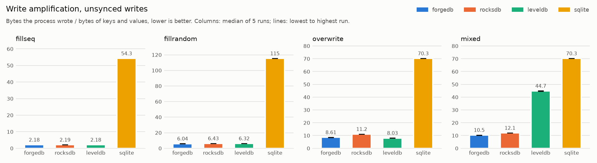
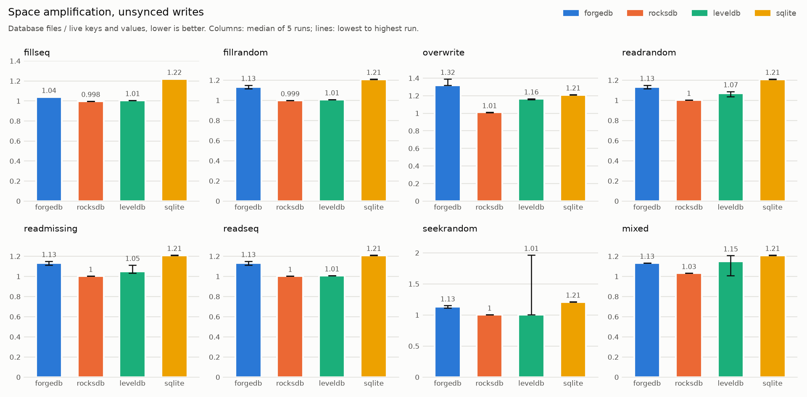
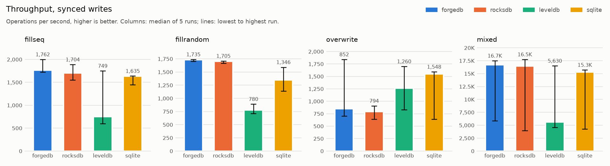
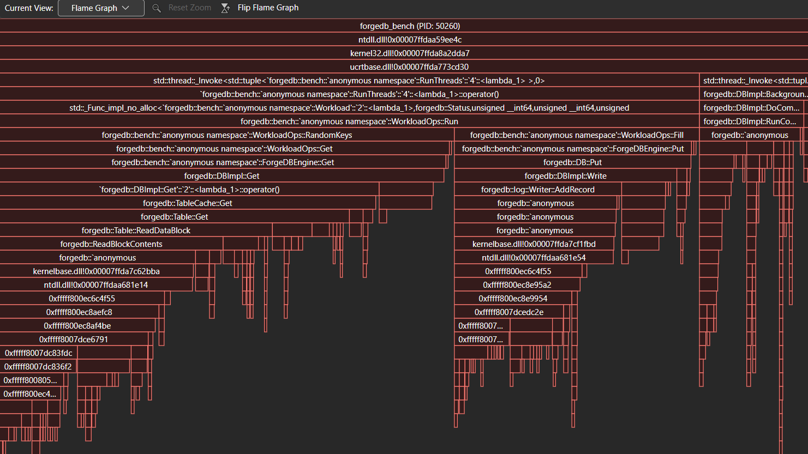
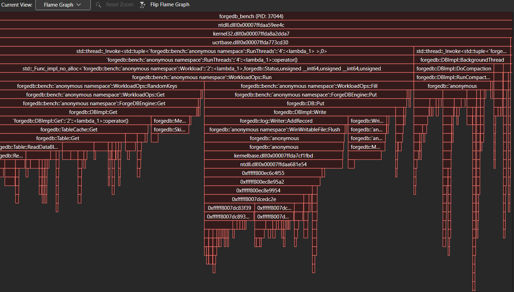
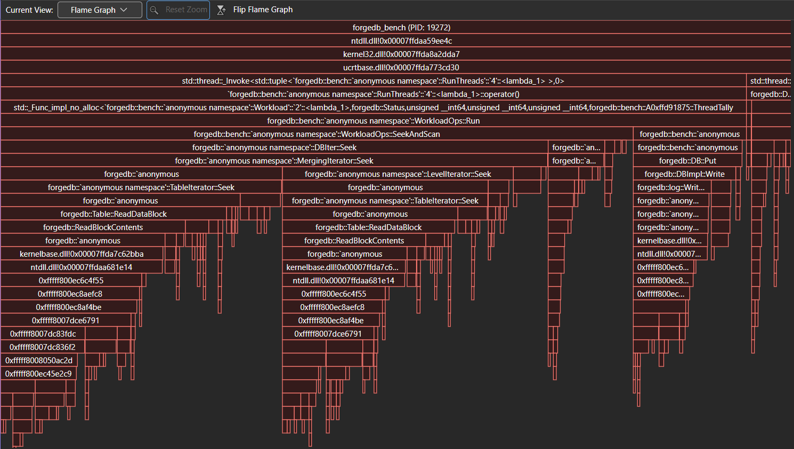
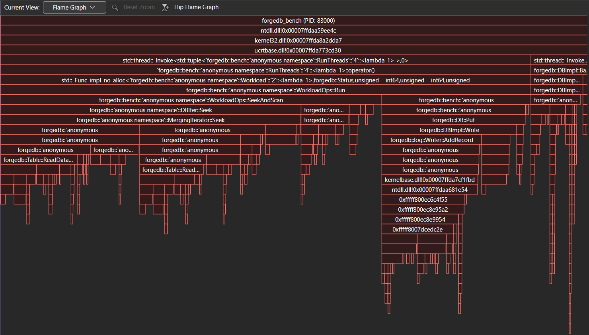

# Benchmarks

ForgeDB against RocksDB, LevelDB and SQLite on one Windows machine, with the same workloads, the
same data and the same settings where the engines have them. Everything here comes from
`scripts\bench.ps1` and `bench\plot.py`; the numbers are measured, never estimated.

## Results: unsynced writes (first run, 2026-11-02)

**Status.** The first full run, before any Phase 5.3 optimization (commit 314d43e). The final
numbers come from a run after 5.3, on the final code, with the machine set up as described
below. Synced writes: [their own section](#results-synced-writes-2026-11-02).

**Machine.** Dell G5 5500 laptop: Intel Core i7-10750H (6 cores, 12 threads), 15.8 GB RAM at
2933 MHz, SK hynix PC611 1 TB NVMe SSD; Windows 11 Home 25H2 (build 26200.9711), on AC power.
MSVC 19.51 (Visual Studio 18), Release (`/O2 /Ob2`); RocksDB 11.8.1, LevelDB (vcpkg 2026-03-11),
SQLite 3.53.4. **Two departures from the method:** the power plan was Balanced, not High
performance, and whether Defender skipped the database folder could not be read (the script
did not run as an administrator). Both would affect every engine; across the 5 runs, most
results vary by a few percent, far less than the gaps between engines.

1,000,000 keys of 16 B with 100-byte values, one thread, 8 MiB cache, 4 MiB write buffer, 10-bit
Bloom filters, no compression, unsynced. Median [lowest–highest] of 5 runs.

| ops/s | ForgeDB | RocksDB | LevelDB | SQLite |
|---|---|---|---|---|
| fillseq | 160K [130K–176K] | 126K [125K–127K] | 183K [178K–184K] | 21.3K [20.8K–24.2K] |
| fillrandom | 151K [145K–151K] | 107K [98.9K–109K] | 154K [153K–155K] | 5,879 [5,858–5,904] |
| overwrite | 136K [134K–136K] | 102K [100K–103K] | 143K [142K–146K] | 8,525 [8,437–8,596] |
| readrandom | 90K [86.8K–91.8K] | 66.8K [66K–67.8K] | 344K [333K–351K] | 53.9K [53.3K–59.3K] |
| readmissing | 358K [352K–366K] | 486K [479K–497K] | 405K [396K–408K] | 54.9K [53.1K–55.6K] |
| readseq | 1.89M [1.79M–1.92M] | 2.57M [2.53M–2.66M] | 3.79M [3.7M–3.83M] | 2.26M [2.2M–2.36M] |
| seekrandom | 28K [27K–28.9K] | 36.9K [36.2K–37.1K] | 142K [141K–143K] | 46.8K [46.3K–46.9K] |
| mixed | 95.2K [94.1K–96.3K] | 64.8K [63.8K–65.7K] | 228K [205K–231K] | 37.1K [35.9K–38K] |

| write amplification | ForgeDB | RocksDB | LevelDB | SQLite |
|---|---|---|---|---|
| fillseq | 3.09 | 2.19 | 2.18 | 54.3 |
| fillrandom | 6.04 [6.02–6.12] | 6.43 | 6.32 [6.30–6.34] | 115 |
| overwrite | 8.61 [8.51–8.64] | 11.2 | 8.03 [8.02–8.12] | 70.3 |
| mixed | 10.5 [10.1–10.5] | 12.1 | 44.6 [44.4–45.0] | 70.3 |






### Where ForgeDB wins

- **Writes.** ForgeDB writes as fast as LevelDB (fillrandom 151K vs 154K ops/s) and about 40%
  faster than RocksDB (107K), with the lowest write amplification in fillrandom (6.04; LevelDB's
  is lower in overwrite, 8.03 against 8.61). RocksDB's adapter keeps its statistics switched on
  (for the counters the benchmark reports), which costs RocksDB some of that gap; how much was
  not measured.
- **Against RocksDB's reads.** readrandom 90K vs 66.8K ops/s, and mixed 95.2K vs 64.8K.

### Where ForgeDB loses, and why

- **Point reads: LevelDB is 3.8 times as fast** (readrandom 344K vs 90K ops/s; typical latency
  2.4 µs vs 11.3 µs), and mixed follows (228K vs 95.2K). The data is 14 times the 8 MiB block
  cache, so most random reads need a block from a table file. ForgeDB does that with a
  `ReadFile` call per block; LevelDB on 64-bit Windows maps up to 1,000 table files into memory
  and reads blocks from the mapping, with no system call (`util/env_windows.cc`, the vcpkg
  version). RocksDB, which also reads with a call per block, has a typical latency close to
  ForgeDB's (13.8 µs). That points to the read path; profiling in 5.3 is to confirm it. A second
  possible factor: LevelDB keeps compacting during reads (below), which may leave fewer tables
  for a read to look in.
- **Seeks and scans: the slowest of the four.** seekrandom 28K ops/s, against 36.9K (RocksDB),
  46.8K (SQLite) and 142K (LevelDB); readseq 1.89M entries/s, against 2.26M to 3.79M. A seek
  reads a block from every level that has the key range, so it pays the per-block cost several
  times; why ForgeDB is behind RocksDB here as well is for the profiler.
- **Absent keys: RocksDB is faster** (readmissing 486K vs 358K ops/s). These are answered by the
  Bloom filters without reading a block; RocksDB's filter differs from ForgeDB's (and LevelDB's).
  Not investigated yet.
- **Sequential writes rewrite data.** In fillseq, ForgeDB wrote 220 MB of tables (flushes and
  compactions) for 116 MB of data; LevelDB and RocksDB wrote 110 and 116 MB, their flushes only,
  because sorted tables that overlap nothing below can move down a level whole. ForgeDB compacts
  all of level 0 at once and does not move whole tables, hence write amplification 3.09 against
  2.19.
- **Space: 13% over the data after fillrandom** (1.13, against 1.00 for RocksDB and 1.01 for
  LevelDB). fillrandom writes every key once, so this is not old versions of keys. One lead:
  ForgeDB keeps the log its last flush retired (see the synced results, below); not confirmed.

### The other engines

- **LevelDB compacts while it only reads.** During readrandom, with no writes at all, LevelDB's
  compactions wrote 133 MB, and 121 MB during seekrandom: its seek-triggered compactions, which
  compact a table that reads keep having to look into before finding their key in a deeper
  level. The same
  explains its mixed write amplification of 44.6 (481 MB of compaction for 11.6 MB written).
  This background work runs on another thread, outside the measured operations.
- **SQLite** is a B-tree with one transaction per write here, so every write rewrites at least
  one 4 KiB page into its log: write amplification 54–115, and 6–21K writes per second. Its
  scans are fast (2.26M entries/s): a B-tree keeps each key once, in order.

## Results: synced writes (2026-11-02)

**Run.** Commit 8821349 (the engines' code is that of the unsynced run), the same laptop, now as
the method asks: High performance power plan, AC power, the database folder excluded from
Defender's scanning (confirmed), and the runs interleaved across engines. The four write
workloads, 20,000 keys, every write synced; 5 runs each.

| ops/s | ForgeDB | RocksDB | LevelDB | SQLite |
|---|---|---|---|---|
| fillseq, median [min–max] | 1,762 [1,724–2,000] | 1,704 [1,550–1,888] | 749 [599–1,750] | 1,635 [1,445–1,638] |
| fillrandom | 1,735 [1,704–1,739] | 1,705 [1,666–1,710] | 780 [712–891] | 1,346 [1,139–1,592] |
| overwrite | 852 [704–1,841] | 794 [639–908] | 1,260 [830–1,701] | 1,548 [638–1,593] |
| mixed (10% synced writes) | 16.7K [5,890–17.5K] | 16.5K [3,985–17.8K] | 5,630 [4,556–16.5K] | 15.3K [4,250–15.7K] |



**What these numbers measure: mostly the SSD.** A synced write waits for `FlushFileBuffers`, and
on this machine that wait comes in two sizes: about 0.5–0.6 ms (the typical write in most runs,
for every engine) or about 2–3 ms, and the share of slow ones changes from run to run, which is
what the wide ranges show. It is not one engine's doing: ForgeDB alone, run after run, went from
28 s to 77–86 s for the same work in the first full run; and interleaving the engines did not
make it fall evenly. In this run the fills were slow for LevelDB in 9 of 10 runs while the
other engines' runs between them were mostly fast; in the first run it was the other way round. The
cause is not known (the drive's own background work is one candidate), so the medians above say
which runs the slow flushes landed in, not how fast an engine is.

**What does hold.** When the flushes are fast, every engine is held to the drive's flush time:
the best runs are within 20% of each other (fillseq: ForgeDB 2,000 writes/s, RocksDB 1,888,
LevelDB 1,750, SQLite 1,638), at a typical 0.49–0.59 ms per write, with ForgeDB at the top of
that range. Write amplification is 1.19 for the three LSM engines in the fills
(just the log; 20,000 keys never fill a write buffer) and 54–78 for SQLite.

**Space after synced overwrite: ForgeDB 3.78, LevelDB 2.11, RocksDB 1.64.** At this size one
flush has happened, and ForgeDB keeps the log that flush retired until the next MANIFEST
record (ADR 0007), as well as the current one; LevelDB deletes the old log after the flush. The
same retired log, up to one write buffer's worth, is a lead for the 13% in the unsynced results.

## Phase 5.3: two optimizations

Profiled with `scripts\cpu-profile.ps1` (Visual Studio's CPU sampling, Release build with
symbols), then measured with `bench.ps1 -Modes unsynced -Engines forgedb`: ForgeDB alone,
1,000,000 keys, 5 runs, median. **Before:** commit 45b186f, 2026-11-03 (High performance plan;
Defender exclusion not confirmed). **After:** commit e016e15, 2026-11-04 (Balanced plan; the
exclusion confirmed). The settings differ between the two runs; the first full run showed
ForgeDB within a percent or two on Balanced and High performance (readrandom 90.0K and 89.6K
ops/s), and the workloads neither change touches stayed within 2% here, so the differences
below are the changes'.

| ForgeDB, unsynced | before | after | change |
|---|---|---|---|
| readrandom, ops/s (p50 latency) | 89.6K (10.8 µs) | 137.5K (6.9 µs) | +53% |
| seekrandom, ops/s (p50 latency) | 28.6K (34.8 µs) | 53.9K (18.4 µs) | +89% |
| readseq, entries/s | 1.94M | 2.43M | +25% |
| mixed (90% reads), ops/s | 97.5K | 155.7K | +60% |
| readmissing, ops/s | 369K | 370K | none (no block is read) |
| fillseq, ops/s | 157K | 164K | +4% |
| fillseq, write amplification | 3.09 | **2.18** | tables written: 220 MB → 115 MB |
| fillrandom, overwrite, ops/s | 147K, 139K | 145K, 136K | −1%, −2% |
| fillrandom, overwrite, write amplification | 6.04, 8.61 | 6.04, 8.61 | none |

### 1. Table blocks read from a memory mapping

**Profile before.** In seekrandom (with its fillrandom setup), 61% of the samples were in the
Windows kernel, and `Table::ReadDataBlock` took 54.7% of the time, nearly all of it in the
`ReadFile` call under it. In readrandom, half of `DBImpl::Get`'s time (26% of all samples) was
in `ReadFile`.

**Change.** A table file is mapped read-only into memory when it is opened, and a read copies
the requested bytes from the mapping instead of calling `ReadFile` (`src/env/win_file_system.cpp`;
ADR 0002, rule 12). Copying (rather than handing out pointers into the mapping, as LevelDB does)
keeps a disk error an `IOError`: the copy catches the in-page error Windows raises, and nothing
above `src/env` changed.

**After.** The deep kernel stacks under `ReadDataBlock` are gone from both profiles; what remains
in the kernel is the log's `WriteFile` under `Put` in the setup fill. Point reads +53%, seeks
+89%, scans +25%. Absent keys, which the Bloom filters answer without reading a block, did not
move: the gain is where the reads were.






### 2. Level-0 tables that overlap nothing move down whole

**Before.** A level-0 compaction rewrote every level-0 table, even when the tables overlapped
neither each other nor level 1, as sequential writes make them: fillseq wrote 220 MB of tables
(35 flushes and 59 compactions) for 116 MB of data.

**Change.** Such tables now move to level 1 unchanged, as a single table already did from deeper
levels (`Compaction::IsTrivialMove`; ADR 0008, rule 2).

**After.** fillseq writes only its flushes (115 MB of tables; the 37 compactions are all moves),
write amplification 2.18, the same as LevelDB's 2.18 in the first run. Throughput +4%. Random
writes are unchanged, to the byte: their tables overlap, so they never qualified.

Both changes keep the full test suite green in every preset (2026-11-03, commit e016e15: 567–570
tests per preset, including new tests for each change).

### Still behind

These numbers compare ForgeDB with itself; the other engines are measured again in the final run.
Against the first run's figures, LevelDB's point reads (344K ops/s) and seeks (142K) are still
ahead of ForgeDB's 137.5K and 53.9K. Where the rest of that gap comes from has not been profiled
yet; one difference is known: LevelDB hands out pointers into its mapping and skips the copy and
the block cache, which ForgeDB keeps for its error handling.

## Running them

Once per machine, in an administrator PowerShell (run `bench.ps1` from one too: reading
Defender's exclusions needs an administrator, so otherwise the script cannot confirm the
exclusion):

```powershell
# Defender scans every file a program writes; the benchmark writes gigabytes.
# The folder is bench.ps1's -DbFolder: by default out\bench-db in the repository.
Add-MpPreference -ExclusionPath <repository>\out\bench-db
# The High performance plan (on laptops that hide it, use Settings > System > Power >
# Power mode: Best performance instead).
powercfg /setactive SCHEME_MIN
```

Remove the exclusion afterwards with `Remove-MpPreference -ExclusionPath <folder>` if you like. Then, in a normal PowerShell, with
the laptop plugged in and other heavy programs (browsers, IDE indexing, sync clients, updates)
closed:

```powershell
pip install matplotlib        # once, for the charts
powershell -ExecutionPolicy Bypass -File scripts\bench.ps1
```

The script builds `forgedb_bench` with the `msvc-bench` preset (Release; the first build compiles
RocksDB through vcpkg, about 15 minutes), checks the power plan, AC power and the Defender
exclusion (it warns, it never changes them), records the machine, runs everything, and draws the
charts. The results go to `out\bench\<date-time>\`: `machine.json`, `unsynced.json`,
`synced.json`, their console logs, `*.png` and `results.md`. Expect one to two hours with the
defaults; `-Runs 1 -Num 100000` gives a quick look, and `python bench\plot.py <folder>` redraws the
charts.

## Method

- **Runs.** Every engine and workload runs 5 times (`-Runs`), each time on a new database, and
  the charts and tables show the median with the lowest and highest run. One run is not a result.
  The runs are interleaved (run 1 of every engine, then run 2 of every engine, ...), so a slow
  spell of the machine falls on every engine alike: the first full run, with each engine's runs
  back to back, saw synced writes take either about 0.55 ms or 1.5–2 ms, a state that lasted
  across several runs.
- **Two modes.** *Unsynced*: every workload, 1,000,000 keys; a write returns once the engine has
  it in its log, which survives a process crash but not a power loss. *Synced*: the four write
  workloads, 50,000 keys; every write waits until its log is on the disk. Reads do not depend on
  the mode, so the synced runs skip them.
- **Data.** 16-byte keys (zero-padded numbers: key 2*i* exists, 2*i* + 1 does not), 100-byte
  values that no engine could compress (none does). 1,000,000 keys are about 116 MB of keys and
  values.
- **Workloads** (`tools/bench/bench_options.h`). `fillseq` and `fillrandom` write every key once
  into an empty database, in order or shuffled. Every other workload first fills a database with
  `fillrandom` (not measured) and waits for its background work to finish, then measures:
  `overwrite` (random writes to existing keys), `readrandom` (random existing keys),
  `readmissing` (random absent keys: the Bloom filter's case), `readseq` (one full scan),
  `seekrandom` (seek to a random key, read 10 entries) and `mixed` (90% reads, 10% writes).
  Every read checks its answer; a wrong one fails the run.
- **Measured.** Operations per second; latency percentiles from a histogram that reads at most
  6.25% high; write amplification = bytes the process wrote to disk (Windows I/O counters, logs
  included) from the start of the workload until the background work settles ÷ bytes of keys and
  values written; space amplification = size of the database's files ÷ live keys and values.
- **One thread** by default (`forgedb_bench --threads=N` for more).

### The same settings for every engine

Each adapter (`tools/bench/*_engine.h`) maps the shared settings to its engine's options and
leaves everything else at the engine's defaults.

| Setting | ForgeDB | RocksDB | LevelDB | SQLite |
|---|---|---|---|---|
| Block cache, 8 MiB | block cache | LRU block cache | LRU block cache | page cache (per connection) |
| Write buffer, 4 MiB | memtable | write buffer | write buffer | log checkpointed at 4 MiB |
| Bloom filters, 10 bits per key | yes | yes | yes | none (a B-tree has no filters) |
| Compression | none (has none) | off | off | none (has none) |
| Sync mode | `WriteOptions::sync` | `WriteOptions::sync` | `WriteOptions::sync` | `synchronous = FULL`; unsynced `NORMAL` |
| Waiting for background work | its own wait | `WaitForCompact` | polls its table list (see below) | a log checkpoint |

Defaults that differ and matter:

- **RocksDB** sizes its levels from the bottom up (`level_compaction_dynamic_level_bytes`) with
  a 256 MiB level 1 and 64 MiB files, and runs two background jobs. ForgeDB and LevelDB use a
  10 MiB level 1, 2 MiB files and one background thread.
- **LevelDB** has no call that waits for its compactions, so its adapter waits until LevelDB's
  compaction scores are all below 1 and its table list has not changed for 1 second. That second
  is in LevelDB's settle time, not in its throughput.
- **SQLite** is a B-tree in one file (`WITHOUT ROWID` table, WAL journal mode, 4 KiB pages), one
  transaction per write. Its cache belongs to a connection, and each thread has its own
  connection, so with N threads it has N caches.

## Caveats

- **The data fits in memory.** 116 MB of keys and values fit in the operating system's file
  cache, and every engine reads through it, so the read workloads measure each engine's code
  (lookups, filters, caching) more than the disk. A larger data set would show disk behavior
  and is not part of these runs.
- **Builds.** vcpkg builds RocksDB with `PORTABLE=1` (no instructions beyond the baseline x86-64
  ones at compile time) and LevelDB with its `crc32c` feature (hardware CRC-32C, as ForgeDB
  uses). All four engines are built by the same compiler with the build's release flags; the
  exact versions and flags are in each run's `machine.json`.
- **One machine, one disk.** The numbers say how these engines compare on that machine. Laptop
  CPUs change speed with temperature and power state, which the 5 runs and the min–max ranges
  show but do not remove.
- **Defaults are not tuning.** Each engine runs with its defaults apart from the shared settings;
  any of them could be tuned for a given workload, ForgeDB included.
